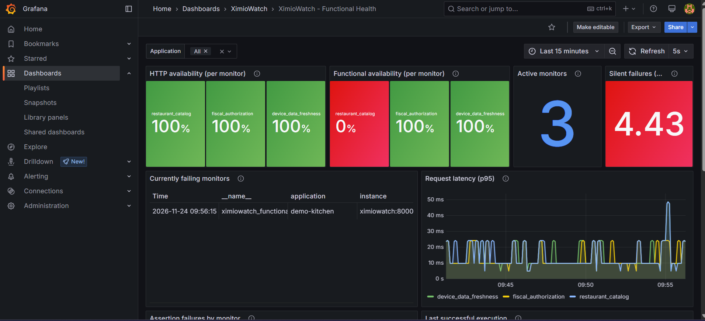
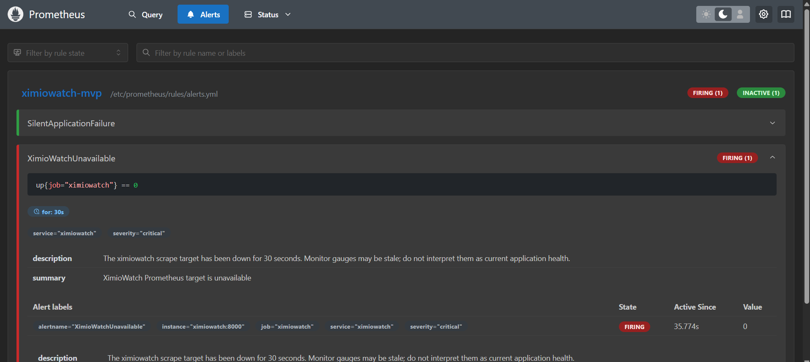

# XimioWatch

[](https://github.com/ximiodev/ximio-watch/actions/workflows/tests.yml)

> **MVP v0.1.0 — early-stage open-source SaaS application monitoring.** XimioWatch
> checks whether a business workflow still works, not just whether a service answers.
> It is intended for learning and demonstration, not for monitoring real production
> workloads.

## Purpose

Infrastructure health, HTTP 200 responses and low latency are not enough: all three
can look healthy while a business workflow is broken. An empty product catalog, an
authorized invoice with no authorization code, or a device that reports "online"
while its data is hours old are **silent failures** that basic uptime checks miss.

XimioWatch sends small scheduled HTTP requests and checks the *meaning* of each
response with configurable business and content assertions. It separates three
signals:

- **HTTP health** — transport succeeded and the expected status was returned.
- **Functional health** — HTTP health succeeded and business/content assertions passed.
- **Performance health** — configured response-time thresholds passed.

A silent failure is specifically **HTTP health up + functional health down**.
A latency breach alone is a performance failure, not a silent application failure.

The included demo API and scenarios are **fictional and reproducible**: they
simulate failures with independent toggles and do not represent real customer
systems, production incidents or production usage.

## Demonstration screenshots

These captures come from the bundled fictional demo stack.

### Healthy application


**Healthy application.** All monitors are fresh and healthy while the demo
application is available.

### Silent application failure with successful HTTP



**Silent application failure with successful HTTP.** The endpoint still responds
successfully, but a business/content assertion fails, so functional health is down.

### Prometheus alert firing


**Prometheus alert firing.** `SilentApplicationFailure` is firing while the HTTP
side remains available.

### Monitoring engine unavailable



**Monitoring engine unavailable.** `XimioWatchUnavailable` is active and monitors
are shown as unknown/stale, not healthy and not application-down.

## Architecture overview

```
config/monitors.yaml ──► MonitorEngine (asyncio, one task per monitor)
                              │
                              ├─► HTTPX request ──► target application
                              ├─► Assertion engine (JSON paths, no eval)
                              ├─► Prometheus metrics ──► /metrics ──► Prometheus ──► Grafana
                              ├─► Prometheus alert rules (/alerts)
                              ├─► JSON structured logs (stdout)
                              └─► OpenTelemetry spans (created locally; optional OTLP export)

demo-api (FastAPI) ── fictional scenarios with independently switchable business failures
```

The monitor service and demonstration API are separate processes. Prometheus
scrapes XimioWatch every 5 seconds and evaluates alert rules every 5 seconds.
Grafana provisions its Prometheus datasource and dashboard automatically.

## Technology stack

**Supported Python target: Python 3.12.** The container images and CI workflow use
Python 3.12, and Python 3.12 is the recommended version for local development.
The stack uses HTTPX, PyYAML, Pydantic, Prometheus Python Client, OpenTelemetry,
FastAPI, Uvicorn, Pytest, Docker, Docker Compose, Prometheus and Grafana.
Runtime and test dependencies are pinned; application images install runtime
dependencies only.

## Quick start

```bash
docker compose up --build -d
docker compose ps
```

Services and host ports (all bound to localhost):

| Service | URL |
| --- | --- |
| XimioWatch metrics | http://localhost:8000/metrics |
| XimioWatch health | http://localhost:8000/healthz |
| Demonstration API | http://localhost:8001 |
| Prometheus | http://localhost:9090 |
| Grafana | http://localhost:3000 |

**Development-only credentials:** Grafana `admin` / `admin` and the demo header
token `demo-token` are local defaults. They are not production credentials.
Override `DEMO_TOKEN` if desired. Grafana sign-up is disabled.

If a host port is already in use, override only the host side (container ports stay fixed):

Bash:

```bash
XIMIOWATCH_PORT=18100 DEMO_API_PORT=18101 PROMETHEUS_PORT=19090 GRAFANA_PORT=13000 \
  docker compose up -d
```

PowerShell:

```powershell
$env:XIMIOWATCH_PORT='18100'; $env:DEMO_API_PORT='18101'
$env:PROMETHEUS_PORT='19090'; $env:GRAFANA_PORT='13000'
docker compose up -d
```

Stop and remove the environment with `docker compose down`.

For local development without Docker:

```bash
python -m venv .venv
# Windows: .venv\Scripts\activate | Linux/macOS: source .venv/bin/activate
python -m pip install -r requirements-dev.txt
# PowerShell
$env:DEMO_API_URL="http://localhost:8001"
# Linux/macOS
# export DEMO_API_URL=http://localhost:8001
uvicorn demo_api.app:app --host 127.0.0.1 --port 8001
# in another terminal:
uvicorn ximiowatch.main:app --host 127.0.0.1 --port 8000
```

## Monitor configuration

Monitor definitions live in [`config/monitors.yaml`](config/monitors.yaml). The
path can be changed with `XIMIOWATCH_CONFIG`. `${NAME}` and `${NAME:default}`
references are resolved from environment variables; a missing variable without a
default is a startup error. Values are never re-evaluated as code.

```yaml
monitors:
  - name: restaurant_catalog          # unique monitor name
    application: demo-kitchen         # bounded metric label
    url: "${DEMO_API_URL:http://localhost:8001}/scenarios/restaurant-catalog"
    method: GET
    headers:
      X-Demo-Token: "${DEMO_TOKEN:demo-token}"
    interval_seconds: 10
    timeout_seconds: 2
    assertions:
      - type: http_status
        value: 200
      - type: json_exists
        path: products
      - type: json_not_empty
        path: products
      - type: max_response_time
        value: 1.5
```

Each monitor runs in its own asyncio task. A timeout, connection error or exception
in one monitor cannot stop the others. Metrics for one execution are recorded once.

### Scheduling and timeout behavior

- Scheduling is **fixed-delay**: after a check finishes, the monitor sleeps for
  `interval_seconds`. The effective period is `interval_seconds + check duration`;
  a slow target reduces check frequency. There is no drift compensation.
- `timeout_seconds` is passed to HTTPX as an operation timeout (connect, read,
  write and pool), **not** a total wall-clock budget. A slow-drip response can
  exceed it in aggregate.
- Freshness evaluation uses a conservative threshold of
  `3 * interval_seconds + timeout_seconds + 5s` (the trailing 5 seconds accounts
  for the Prometheus scrape interval).

### Supported assertions

| Type | Passes when | Example |
| --- | --- | --- |
| `http_status` | status code equals `value` | `{type: http_status, value: 200}` |
| `max_response_time` | request duration ≤ `value` seconds (performance only) | `{type: max_response_time, value: 1.5}` |
| `json_exists` | dotted `path` resolves in the JSON body | `{type: json_exists, path: invoice.code}` |
| `json_equals` | value at `path` equals `value` (type-aware) | `{type: json_equals, path: authorized, value: true}` |
| `json_not_empty` | field exists, is not null and is non-empty | `{type: json_not_empty, path: products}` |
| `numeric_gt` | numeric field > `value` | `{type: numeric_gt, path: count, value: 0}` |
| `numeric_lt` | numeric field < `value` | `{type: numeric_lt, path: last_event_age_seconds, value: 300}` |
| `conditional` | `then` is checked only when `when` passes; optional `otherwise` | see below |

Dotted paths also index arrays, for example `products.0.available`. Invalid JSON,
missing fields, wrong types, timeouts and connection errors become failed checks,
never application crashes. No `eval`, shell execution or arbitrary expressions are used.

**Null and missing-field semantics**

- `json_exists` passes for a present field whose value is `null`; use
  `json_equals` with a concrete value when null must fail.
- `json_not_empty` fails for `null`, empty strings/lists/dicts and missing fields.
  It treats `false` and `0` as present non-empty values.
- `json_equals` is type-aware: `true` does not equal `1`.
- Numeric comparisons reject booleans and non-numeric values.

**Conditional semantics**

```yaml
      - type: conditional
        when:
          type: json_equals
          path: authorized
          value: true
        then:
          type: json_exists
          path: authorization_code
        otherwise:
          type: json_equals
          path: authorized
          value: false
```

A failed `when` guard skips `then`; if no `otherwise` is configured, the conditional
contributes no assertion result and therefore does not fail the check. Because of
this, the fiscal demonstration monitor also has a standalone
`json_equals path: authorized value: true` assertion so a missing, null or `false`
authorization state can never pass merely because both branches were skipped.

If no `http_status` assertion is configured, any 2xx/3xx response counts as HTTP
available; other responses are HTTP failures. Functional health always requires
HTTP health first, so a 5xx response can never be functionally healthy even when
the JSON body otherwise looks valid.

## Metrics

All metrics use the prefix `ximiowatch_` and bounded labels (`monitor`,
`application`, fixed `outcome`/`type` values). No credentials, headers, raw bodies
or application field values are exported.

| Metric | Type | Meaning |
| --- | --- | --- |
| `ximiowatch_http_up` | Gauge | `1` when HTTP transport and status health passed |
| `ximiowatch_functional_up` | Gauge | `1` when HTTP health and business/content assertions passed |
| `ximiowatch_performance_up` | Gauge | `1` when configured latency thresholds passed; absent when none configured |
| `ximiowatch_performance_configured` | Gauge | `1` when a `max_response_time` assertion is configured |
| `ximiowatch_monitor_interval_seconds` | Gauge | Configured fixed delay between completed checks |
| `ximiowatch_monitor_timeout_seconds` | Gauge | Configured HTTPX operation timeout |
| `ximiowatch_checks_total` | Counter | Executions by `outcome` (`success`, `functional_failure`, `performance_failure`, `http_failure`, `timeout`, `connection_error`, `error`) |
| `ximiowatch_assertion_failures_total` | Counter | Failures by assertion `type` |
| `ximiowatch_silent_failures_total` | Counter | HTTP available + business/content assertion failure only |
| `ximiowatch_request_duration_seconds` | Histogram | Duration of completed HTTP responses |
| `ximiowatch_consecutive_failures` | Gauge | Consecutive HTTP or functional failures; latency-only failures do not increment it |
| `ximiowatch_last_success_timestamp_seconds` | Gauge | Last fully healthy check (HTTP + functional + configured performance) |
| `ximiowatch_last_check_timestamp_seconds` | Gauge | Last completed check, including unsuccessful checks |

Notes:

- A configured performance check with no valid latency measurement (for example a
  timeout) records `performance_up = 0`; it is not reported healthy.
- Counters and gauges are in-process and reset when XimioWatch restarts. Prometheus
  handles counter resets; historical continuity depends on Prometheus retention.

### Logging and tracing

Each check emits one JSON log line with monitor, application, outcome, HTTP,
functional and performance flags, status, duration, failed assertion types and
silent-failure flag. `LOG_LEVEL` controls verbosity. Response bodies, headers,
monitored URLs with query secrets, raw exception messages and stack traces are
never logged.

Every check creates one local OpenTelemetry span (`ximiowatch.monitor.check`)
with sanitized attributes: monitor, application, status, outcome, duration,
failed assertion types and error class name. Spans are **created locally and
discarded by default**; no trace backend or visualization is included in the MVP.
To export via OTLP/HTTP, set:

```bash
OTEL_TRACES_EXPORTER=otlp
OTEL_EXPORTER_OTLP_ENDPOINT=http://your-collector:4318
```

`OTEL_TRACES_EXPORTER` defaults to `none`. Only exporter setup, not a collector,
is provided.

## Prometheus alerting

A small rules file is mounted from
[`prometheus/rules/alerts.yml`](prometheus/rules/alerts.yml) and loaded by the
existing Prometheus service. Thresholds are **demonstration defaults**, not
production tuning.

| Alert | Condition | `for` |
| --- | --- | --- |
| `SilentApplicationFailure` | HTTP up, functional down, recent measurement, XimioWatch target up | `30s` |
| `XimioWatchUnavailable` | `up{job="ximiowatch"} == 0` | `30s` |

Alerts are visible at Prometheus `/alerts`. There is **no Alertmanager or
notification integration** in this MVP.

## Simulated failure scenarios

The demonstration API exposes three generic fictional SaaS scenarios. Each
failure toggles independently; `GET /healthz` on the demo API always returns
HTTP 200 while these failures are enabled.

| Scenario | Healthy | Failure |
| --- | --- | --- |
| `restaurant_catalog` | non-empty catalog | HTTP 200 with empty `products` |
| `fiscal_authorization` | authorized invoice with `authorization_code` | HTTP 200 with no authorization code |
| `device_data_freshness` | `last_event_age_seconds: 2` | HTTP 200 with `last_event_age_seconds: 7200` |

Bash:

```bash
curl -X POST http://localhost:8001/simulation/restaurant_catalog/failure \
  -H "Content-Type: application/json" -d '{"enabled":true}'
curl -X POST http://localhost:8001/simulation/fiscal_authorization/failure \
  -H "Content-Type: application/json" -d '{"enabled":true}'
curl -X POST http://localhost:8001/simulation/device_data_freshness/failure \
  -H "Content-Type: application/json" -d '{"enabled":true}'
```

PowerShell:

```powershell
foreach ($scenario in 'restaurant_catalog','fiscal_authorization','device_data_freshness') {
  Invoke-RestMethod -Method Post `
    -Uri "http://localhost:8001/simulation/$scenario/failure" `
    -ContentType 'application/json' -Body '{"enabled":true}'
}
```

Check state with `curl -s http://localhost:8001/simulation`. Disable a scenario by
posting `{"enabled":false}`.

During a silent failure, expect `http_up = 1`, `functional_up = 0`, an incremented
`silent_failures_total`, and demo `/healthz` still reporting `"status":"ok"`.

## Grafana dashboard

Open http://localhost:3000 and select **XimioWatch - Functional Health**. Panels
distinguish:

- **Current healthy monitors (%)** — fresh, scrapeable and fully healthy monitors.
- **Current failing monitors** — fresh monitors with HTTP, functional or performance failure.
- **Unknown or stale monitors** — no recent measurement or XimioWatch scrape target down.
- **Current monitor state** — healthy / failing / unknown-or-stale per monitor.
- **Historical check-based availability (%)** — averaged observations over the selected range.

Historical panels keep valid observations and show gaps when data is unavailable;
they do not substitute artificial zeros for missing data. A failed Prometheus
scrape is not interpreted as an application failure. The dashboard uses
`up{job="ximiowatch"}` and `last_check_timestamp_seconds` freshness guards, not
`last_success_timestamp_seconds`. Unknown-state views retain the last known
monitor configuration for 5 minutes via `last_over_time`, so a short exporter
outage shows monitors as unknown rather than healthy or application-down. An
outage longer than five minutes can remove monitor identities from current views;
see [Current limitations](#current-limitations).

## Tests

```bash
python -m pip install -r requirements-dev.txt
python -m pytest -q
```

Tests use HTTPX mock transports and isolated Prometheus registries; they need no
Docker, network connection or demonstration API. Coverage includes assertion
semantics, HTTP/functional/performance separation, latency-only and combined
failures, exact-once metric recording, sanitized diagnostics, alert rule structure,
monitor isolation, configuration validation, environment expansion, recovery and
the direct `/metrics` endpoint.

GitHub Actions runs the same suite on Python 3.12 via
[`.github/workflows/tests.yml`](.github/workflows/tests.yml).

## Reproducible demonstration walkthrough

1. **Healthy application** — start the stack, open the dashboard, show all three
   monitors green and demo `/healthz` returning `ok`.
2. **HTTP 200 with broken business response** — trigger Scenario A. Show that the
   catalog endpoint still returns HTTP 200 but `functional_up` becomes `0`.
3. **Prometheus alert transition** — wait ~30 seconds and show
   `SilentApplicationFailure` moving from pending to firing at Prometheus `/alerts`.
4. **Application recovery** — disable the scenario; show `functional_up = 1`,
   `consecutive_failures = 0`, and the alert resolving.
5. **Monitoring-engine unavailability** — `docker compose stop ximiowatch`, wait
   ~30 seconds, show `XimioWatchUnavailable` firing and the dashboard reporting
   monitors as unknown/stale, not healthy and not application-down. Restart with
   `docker compose start ximiowatch`.

## Current limitations

- Polling only; fixed-delay scheduling is not drift-compensated.
- HTTPX timeouts are per operation, not a total request budget.
- No notification channels; Prometheus alerts are visible only in `/alerts`.
- No database, authentication, user management, custom frontend or multi-tenancy.
- No Kubernetes, Terraform or cloud deployment.
- No trace backend or trace visualization in the MVP.
- Known-monitor retention: unknown-state dashboard views use
  `last_over_time(...[5m])`. If the XimioWatch exporter is unavailable for more
  than five minutes, monitor identities can disappear from the current dashboard
  because their historical configuration metrics leave the five-minute lookback
  window. `XimioWatchUnavailable` remains active while its condition holds.
- Simulated failures are in-memory and reset when `demo-api` restarts.
- Prometheus and Grafana data is not persisted to named volumes.
- Demo Grafana credentials and demo token are development-only defaults.

## Future enhancements (outside current MVP)

- Notification integrations and longer-term alert tuning.
- Synthetic transaction steps with request chaining and extracted variables.
- Schema-based assertions and richer JSON path filtering.
- Optional tracing backend and exemplar linking.

## License

MIT — see [LICENSE](LICENSE).
