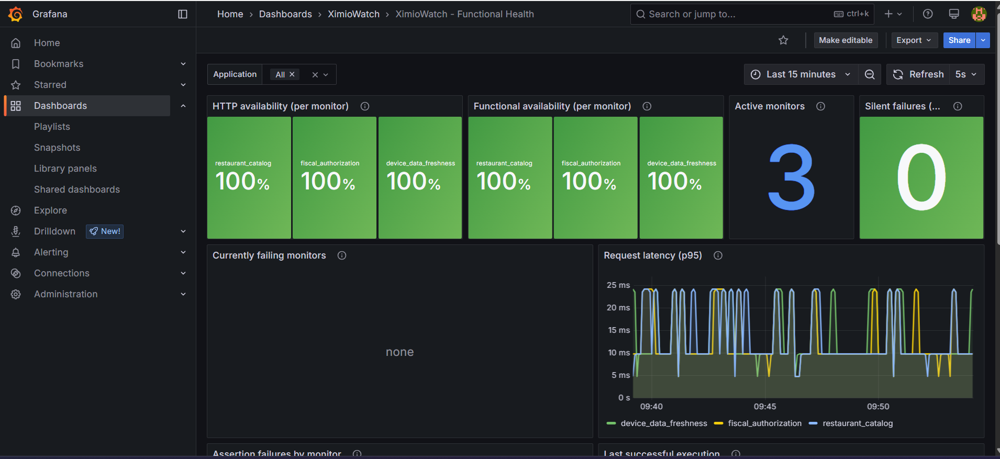
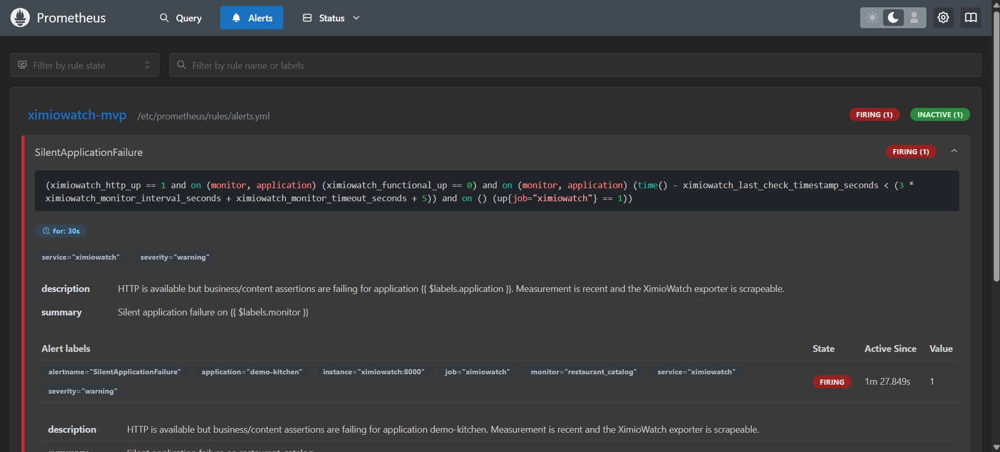

# XimioWatch

[](https://github.com/ximiodev/ximio-watch/actions/workflows/tests.yml)

> **MVP v0.1.0 — early-stage open-source SaaS application monitoring.** XimioWatch
> checks whether a business workflow still works, not just whether a service answers.
> It is intended for learning and demonstration, not for monitoring real production
> workloads.

## Purpose

Infrastructure health, HTTP 200 responses and low latency are not enough: all three
can look healthy while a business workflow is broken. An empty product catalog, an
authorized invoice with no authorization code, or a device that reports "online"
while its data is hours old are **silent failures** that basic uptime checks miss.

XimioWatch sends small scheduled HTTP requests and checks the *meaning* of each
response with configurable business and content assertions. It separates three
signals:

- **HTTP health** — transport succeeded and the expected status was returned.
- **Functional health** — HTTP health succeeded and every applicable business/content
  assertion passed.
- **Performance health** — every applicable response-time threshold passed.

Each dimension has an explicit state: `UP`, `DOWN`, `UNKNOWN` or `NOT CONFIGURED`.
`UNKNOWN` means the dimension is configured but no valid observation exists for the
latest check; it is never treated as healthy or failing. `NOT CONFIGURED` means no
applicable assertion exists.

A silent failure is specifically **HTTP health UP + functional health DOWN**, based on
a confirmed business/content failure. A latency breach alone is a performance
failure, not a silent application failure.

The included demo API and scenarios are **fictional and reproducible**: they
simulate failures with independent toggles and do not represent real customer
systems, production incidents or production usage.

## Demonstration screenshots

These captures come from the bundled fictional demo stack.

### Healthy application



**Healthy application.** All monitors are fresh and healthy while the demo
application is available.

### Silent application failure with successful HTTP


**Silent application failure with successful HTTP.** The endpoint still responds
successfully, but a business/content assertion fails, so functional health is down.

### Prometheus alert firing



**Prometheus alert firing.** `SilentApplicationFailure` is firing while the HTTP
side remains available.

### Monitoring engine unavailable


**Monitoring engine unavailable.** `XimioWatchUnavailable` is active and monitors
are shown as unknown/stale, not healthy and not application-down.

## Architecture overview

```
config/monitors.yaml ──► MonitorEngine (asyncio, one task per monitor)
                              │
                              ├─► per-monitor HTTPX client ──► target application
                              ├─► Assertion engine (JSON/text/content, no eval)
                              ├─► Prometheus metrics ──► /metrics ──► Prometheus ──► Grafana
                              ├─► Prometheus alert rules (/alerts) ──► Alertmanager ──► controlled local webhook
                              ├─► JSON structured logs (stdout)
                              └─► OpenTelemetry spans (created locally; optional OTLP export)

demo-api (FastAPI) ── fictional scenarios with independently switchable business failures
```

The monitor service and demonstration API are separate processes. Prometheus
scrapes XimioWatch every 5 seconds and evaluates alert rules every 5 seconds.
Grafana provisions its Prometheus datasource and dashboard automatically.
Alertmanager is added by a small optional Compose overlay and delivers local
demo notifications only to a controlled webhook; no external notification
destination is contacted.

## Technology stack

**Supported Python target: Python 3.12.** The container images and CI workflow use
Python 3.12, and Python 3.12 is the recommended version for local development.
The stack uses HTTPX, PyYAML, Pydantic, Prometheus Python Client, OpenTelemetry,
FastAPI, Uvicorn, Pytest, Docker, Docker Compose, Prometheus and Grafana.
Runtime and test dependencies are pinned; application images install runtime
dependencies only.

## Quick start

```bash
docker compose up --build -d
docker compose ps
```

Services and host ports (all bound to localhost):

| Service | URL |
| --- | --- |
| XimioWatch metrics | http://localhost:8000/metrics |
| XimioWatch health | http://localhost:8000/healthz |
| Demonstration API | http://localhost:8001 |
| Prometheus | http://localhost:9090 |
| Grafana | http://localhost:3000 |

**Development-only credentials:** Grafana `admin` / `admin` and the demo header
token `demo-token` are local defaults. They are not production credentials.
Override `DEMO_TOKEN` if desired. Grafana sign-up is disabled.

If a host port is already in use, override only the host side (container ports stay fixed):

Bash:

```bash
XIMIOWATCH_PORT=18100 DEMO_API_PORT=18101 PROMETHEUS_PORT=19090 GRAFANA_PORT=13000 \
  docker compose up -d
```

PowerShell:

```powershell
$env:XIMIOWATCH_PORT='18100'; $env:DEMO_API_PORT='18101'
$env:PROMETHEUS_PORT='19090'; $env:GRAFANA_PORT='13000'
docker compose up -d
```

Stop and remove the environment with `docker compose down`.

For local development without Docker:

```bash
python -m venv .venv
# Windows: .venv\Scripts\activate | Linux/macOS: source .venv/bin/activate
python -m pip install -r requirements-dev.txt
# PowerShell
$env:DEMO_API_URL="http://localhost:8001"
# Linux/macOS
# export DEMO_API_URL=http://localhost:8001
uvicorn demo_api.app:app --host 127.0.0.1 --port 8001
# in another terminal:
uvicorn ximiowatch.main:app --host 127.0.0.1 --port 8000
```

## Monitor configuration

Monitor definitions live in [`config/monitors.yaml`](config/monitors.yaml). The
path can be changed with `XIMIOWATCH_CONFIG`. `${NAME}` and `${NAME:default}`
references are resolved from environment variables; a missing variable without a
default is a startup error. Values are never re-evaluated as code.

```yaml
monitors:
  - name: restaurant_catalog          # unique monitor name
    application: demo-kitchen         # bounded metric label
    url: "${DEMO_API_URL:http://localhost:8001}/scenarios/restaurant-catalog"
    method: GET
    headers:
      X-Demo-Token: "${DEMO_TOKEN:demo-token}"
    interval_seconds: 10
    timeout_seconds: 2
    max_response_bytes: 2097152  # 2 MiB decoded body limit (default)
    assertions:
      - type: http_status
        value: 200
      - type: json_exists
        path: products
      - type: json_not_empty
        path: products
      - type: content_type_contains
        value: application/json
      - type: text_contains
        value: catalog-demo-01
      - type: max_response_time
        value: 1.5
```

Each monitor runs in its own asyncio task. A timeout, connection error or exception
in one monitor cannot stop the others. Metrics for one execution are recorded once.

### Health states and evaluation rules

| State | Meaning |
| --- | --- |
| `UP` | The dimension is configured, was evaluated for the latest completed check and passed. |
| `DOWN` | The dimension is configured, was evaluated for the latest completed check and failed. |
| `UNKNOWN` | The dimension is configured, but no valid observation exists for the latest check (for example a timeout, skipped conditional, undecodable body or stale data). |
| `NOT CONFIGURED` | The monitor defines no applicable assertion for that dimension. |

Dimension rules:

- **HTTP** is `UP` only when the request completed and the expected status was
  returned. It is `DOWN` for transport failures and unexpected statuses. HTTP has no
  `NOT CONFIGURED` state; every monitor always has a status policy.
- **Functional** requires HTTP `UP` first. HTTP-only monitors are `NOT CONFIGURED`;
  configured business/content checks that were all skipped are `UNKNOWN`. A failed
  HTTP check never claims that business assertions were evaluated. Invalid JSON,
  missing fields, wrong types, absent required text and confirmed content failures
  are `DOWN`, never a silent pass.
- **Performance** is independent from functional health. A completed HTTP response,
  including a completed non-2xx response, provides a valid latency observation. A
  timeout or incomplete response does not. With no `max_response_time` assertion the
  dimension is `NOT CONFIGURED`; with no applicable branch it is `UNKNOWN`.
- **Silent application failure** requires HTTP `UP` plus functional `DOWN` from a
  confirmed business/content failure. HTTP-only monitors, latency-only breaches,
  unknown/skipped checks and engine outages never increment the silent-failure
  counter.
- `response_too_large` preserves the received status and HTTP state, but business
  assertions are not fabricated: functional health is `UNKNOWN`, not `DOWN`.

Binary `*_up` gauges are emitted only for `UP` or `DOWN`. When a previously healthy
or failing dimension becomes `UNKNOWN`, the stale binary gauge is removed; the
`*_configured` and `*_evaluated` indicators distinguish `UNKNOWN` from
`NOT CONFIGURED`.

### Security and configuration hygiene

`config/monitors.yaml` is a public, fictional example. Private monitor definitions
belong outside the repository or under ignored paths such as `config/private/`,
`config/local/`, `config/production/`, `config/monitors.local.*` and
`config/monitors.production.*`. Sanitized examples may be committed as
`config/monitors.example.yaml` or `config/monitors.*.example.yaml`. The same private
patterns are excluded from the Docker context, and the application image copies only
`config/monitors.yaml`; private runtime configuration is not built into the image.

Credentials should be supplied through environment variables or, in a later runtime
stage, protected secret files. `${NAME}` and `${NAME:default}` references are
resolved when configuration is loaded. Do not put private values directly in tracked
files. Expanded credential values are not written to logs, metrics, spans or
configuration diagnostics.

Configuration validation reports the affected monitor entry, field path and a static
problem category. Raw YAML parser and Pydantic values, causes and contexts are
discarded. Startup logs use the same sanitized diagnostic.

The `secret-scan` workflow runs Gitleaks on pushes and pull requests, and performs a
full-history scan on schedule and manual dispatch. It uses redacted output, minimal
`contents: read` permissions, and does not upload reports or post findings as
comments. No exception is currently needed for the fictional demo values. The
repository owner is a personal account, so the action does not require a Gitleaks
license; organization ownership would require one. Workflow results must be checked
on GitHub; this documentation does not claim that a remote run has passed.

These protections do not make XimioWatch production-ready.

### Startup and initial state

- Service startup starts monitor execution in a background task; it no longer waits
  for the first execution of every configured monitor.
- `/healthz` and `/metrics` are therefore available independently of slow targets.
- Known monitors are still identified by `ximiowatch_monitor_interval_seconds`,
  `ximiowatch_monitor_timeout_seconds`, `ximiowatch_functional_configured`,
  `ximiowatch_performance_configured` and `/monitors`.
- Before a monitor's first completed check, no `ximiowatch_http_up`, binary
  `ximiowatch_functional_up`, binary `ximiowatch_performance_up` or
  `ximiowatch_last_check_timestamp_seconds` observation exists for it. This means
  **unknown / not yet evaluated**, never healthy. The `*_configured` gauges are
  available from startup, and `*_evaluated` gauges report whether the latest check
  produced an applicable observation.
- Shutdown cancels monitor tasks, awaits their completion and closes clients owned
  by the engine. An active streamed response is released during cancellation.

### Scheduling and absolute deadlines

- Scheduling is **fixed-delay**: after a check finishes, the monitor sleeps for
  `interval_seconds`. The effective period is `interval_seconds + check duration`;
  a slow target reduces check frequency. There is no drift compensation.
- `timeout_seconds` is now a **total wall-clock deadline** for the full request
  lifecycle: connection establishment, request transmission, response headers and
  response body streaming. It is enforced with Python 3.12 `asyncio.timeout`.
- HTTPX connect/read/write/pool timeouts are also bounded by `timeout_seconds`, but
  the absolute asyncio deadline remains authoritative even if a transport or a
  slow-drip response would otherwise exceed the aggregate budget.
- A deadline expiry produces the bounded `timeout` outcome. External task
  cancellation is a different event: it is re-raised, never converted into a
  successful or failed check, and never recorded as a completed check.
- Grafana keeps the Stage 3 freshness threshold of
  `3 * interval_seconds + timeout_seconds + 5s` for dashboard compatibility.
- Stage 4 alert rules use a more conservative threshold of
  `3 * interval_seconds + timeout_seconds + 15s`. The 15-second margin covers the
  5-second scrape interval, 5-second rule evaluation interval, fixed-delay
  scheduling jitter and a short scrape retry window. The timeout remains an
  absolute bound rather than a per-operation limit. Shared Prometheus recording
  rules apply this policy and a 60-second process startup grace.

### HTTP execution safety

- Supported methods are **GET and HEAD only**. Other methods are rejected during
  configuration validation. There are no exceptions for state-changing endpoints.
- GET and HEAD alone cannot guarantee that an application endpoint is free of side
  effects. Operators must review the contract of every configured target.
- URLs must use HTTP or HTTPS, contain a valid hostname and contain no embedded
  username or password. Malformed URLs and unsupported schemes are rejected.
  Docker service names, loopback addresses and private-network targets remain
  valid because operator-configured internal monitoring is supported.
- Automatic redirects stay disabled for every request. By default only 2xx
  responses are healthy; unexpected 3xx responses are failures. An explicit
  `http_status` assertion can deliberately accept another code. No authorization
  header or cookie is forwarded to a redirect destination because no redirect is
  followed.
- HTTPS certificate verification remains enabled. There is no TLS-disable option.
  Environment proxy discovery remains disabled (`trust_env=False`).
- Each monitor owns its HTTPX client, preserving connection pooling and keep-alive
  reuse inside that monitor. Cookies are cleared before each check, so cookies
  received during one check cannot affect the next check or another monitor. There
  is no shared global cookie jar to clear concurrently and no browser session
  management.
- Response bodies are streamed and counted while being decoded. The configurable
  `max_response_bytes` limit defaults to **2 MiB of decoded body data**.
  `Content-Length` is never trusted as the enforcement mechanism; compressed
  responses are measured after decoding. When the limit is exceeded, consumption
  stops, the response is closed and the check records the bounded
  `response_too_large` outcome. If the expected status was already received,
  `http_ok` remains true; the failure is never mislabeled as a transport connection
  error. Business and performance assertions are not evaluated for a truncated body,
  so their state is `UNKNOWN` rather than a fabricated `DOWN`.
- Response bodies are never logged, recorded in metrics or added to spans.

### Supported assertions

| Type | Passes when | Example |
| --- | --- | --- |
| `http_status` | status code equals `value` | `{type: http_status, value: 200}` |
| `max_response_time` | request duration ≤ `value` seconds (performance only) | `{type: max_response_time, value: 1.5}` |
| `json_exists` | dotted `path` resolves in the JSON body | `{type: json_exists, path: invoice.code}` |
| `json_equals` | value at `path` equals `value` (type-aware) | `{type: json_equals, path: authorized, value: true}` |
| `json_not_empty` | field exists, is not null and is non-empty | `{type: json_not_empty, path: products}` |
| `numeric_gt` | numeric field > `value` | `{type: numeric_gt, path: count, value: 0}` |
| `numeric_lt` | numeric field < `value` | `{type: numeric_lt, path: last_event_age_seconds, value: 300}` |
| `text_contains` | decoded body contains the case-sensitive string `value` | `{type: text_contains, value: "Ready"}` |
| `text_not_contains` | decoded body does not contain the case-sensitive string `value` | `{type: text_not_contains, value: "ERROR"}` |
| `content_type_contains` | `Content-Type` header contains `value` | `{type: content_type_contains, value: application/json}` |
| `conditional` | `then` is checked only when `when` passes; optional `otherwise` | see below |

Dotted paths also index arrays, for example `products.0.available`. Invalid JSON,
missing fields, wrong types, timeouts and connection errors become failed checks,
never application crashes. No `eval`, shell execution or arbitrary expressions are used.

**JSON and content semantics**

- JSON assertions require a valid JSON body. Invalid JSON is a confirmed functional
  failure when an applicable JSON assertion is attempted (a guard or a selected
  branch); it is not silently skipped. A JSON assertion that exists only in a
  skipped branch is not attempted and does not establish a JSON contract.
- `text_contains` and `text_not_contains` compare against the decoded response body
  and are **case-sensitive**. Their `value` must be a non-empty string.
- Text uses the charset declared in `Content-Type`, or UTF-8 when no charset is
  declared. Unsupported encodings, invalid byte sequences and missing bodies leave
  text assertions `UNKNOWN`; a negative text assertion never passes on an
  undecodable body.
- `content_type_contains` compares case-insensitively against the `Content-Type`
  header value. A missing header, an incompatible header or a non-string/empty
  configured value fails. It is safe for HEAD monitors.
- Body assertions (`json_*`, `numeric_*`, `text_contains`, `text_not_contains`) are
  rejected recursively for HEAD monitors. `content_type_contains` remains valid.
- Text and HTML assertions inspect returned HTTP content only. XimioWatch does not
  execute browser JavaScript, render HTML or run a browser.

**Null and missing-field semantics**

- `json_exists` passes for a present field whose value is `null`; use
  `json_equals` with a concrete value when null must fail.
- `json_not_empty` fails for `null`, empty strings/lists/dicts and missing fields.
  It treats `false` and `0` as present non-empty values.
- `json_equals` is type-aware: `true` does not equal `1`.
- Numeric comparisons reject booleans and non-numeric values.

**Conditional semantics**

```yaml
      - type: conditional
        when:
          type: json_equals
          path: authorized
          value: true
        then:
          type: json_exists
          path: authorization_code
        otherwise:
          type: json_equals
          path: authorized
          value: false
```

A failed `when` guard skips `then` and selects `otherwise` when present. A false
guard is not itself a business failure. Guards are evaluated to choose a branch but
are not counted as required business results; `otherwise` is treated exactly like
`then` and is a required assertion when selected. A monitor whose only business
assertion is a guard has functional health `NOT CONFIGURED`. Latency assertions used
as guards are still valid performance observations.

An empty guard never succeeds, and an unevaluable guard does not fabricate a
branch. When required business assertions are configured, an attempted JSON guard
with an invalid body is a confirmed functional failure; a JSON assertion located
only in a skipped branch is not attempted. A guard-only business configuration
remains `NOT CONFIGURED` and does not claim a functional evaluation.
Configured branches can be nested conditionals; their
business and performance assertions are discovered recursively. If every applicable
business branch is skipped, functional health is `UNKNOWN`, not `UP`. If every
applicable performance branch is skipped, performance health is `UNKNOWN`. Because
skips can hide a broken workflow, the fiscal demonstration monitor also has a
standalone `json_equals path: authorized value: true` assertion so a missing, null
or `false` authorization state can never pass merely because both branches were
skipped.

`http_status` is allowed only as a top-level assertion, including when branches are
nested; a conditional status assertion is rejected at configuration load. Guards
need a real assertion, and ambiguous or unsupported conditional structures are
rejected. There is no general expression language: operators are limited to the
configured assertion types above.

If no `http_status` assertion is configured, only a 2xx response counts as HTTP
available; 3xx and other responses are HTTP failures. An explicit `http_status`
assertion remains authoritative and may intentionally accept a non-2xx code.
Functional health always requires HTTP health first, so a 5xx response can never
be functionally healthy even when the JSON body otherwise looks valid.

## Metrics

All metrics use the prefix `ximiowatch_` and bounded labels (`monitor`,
`application`, fixed `outcome`/`type` values). No credentials, headers, raw bodies
or application field values are exported.

| Metric | Type | Meaning |
| --- | --- | --- |
| `ximiowatch_startup_timestamp_seconds` | Gauge | Unix timestamp when this XimioWatch process started; global, with no monitor/application labels |
| `ximiowatch_http_up` | Gauge | `1` when HTTP transport and status health passed, otherwise `0` |
| `ximiowatch_functional_up` | Gauge | `1` for functional `UP`, `0` for functional `DOWN`; absent for `UNKNOWN` or `NOT CONFIGURED` |
| `ximiowatch_functional_configured` | Gauge | `1` when the monitor defines business/content assertions, `0` otherwise |
| `ximiowatch_functional_evaluated` | Gauge | `1` when the latest check produced an applicable functional observation |
| `ximiowatch_performance_up` | Gauge | `1` for performance `UP`, `0` for `DOWN`; absent for `UNKNOWN` or `NOT CONFIGURED` |
| `ximiowatch_performance_configured` | Gauge | `1` when the monitor defines a `max_response_time` assertion, including inside a conditional |
| `ximiowatch_performance_evaluated` | Gauge | `1` when the latest check produced an applicable latency observation |
| `ximiowatch_monitor_interval_seconds` | Gauge | Configured fixed delay between completed checks |
| `ximiowatch_monitor_timeout_seconds` | Gauge | Configured absolute request deadline |
| `ximiowatch_checks_total` | Counter | Executions by `outcome` (`success`, `functional_failure`, `performance_failure`, `http_failure`, `timeout`, `connection_error`, `error`, `response_too_large`, `not_evaluated`) |
| `ximiowatch_assertion_failures_total` | Counter | Failures by bounded assertion `type` |
| `ximiowatch_silent_failures_total` | Counter | HTTP up plus confirmed business/content failure only |
| `ximiowatch_request_duration_seconds` | Histogram | Duration of completed HTTP responses |
| `ximiowatch_consecutive_failures` | Gauge | Consecutive HTTP, functional or transport failures; latency-only failures do not increment it |
| `ximiowatch_last_success_timestamp_seconds` | Gauge | Last fully healthy check (HTTP + applicable functional and performance dimensions) |
| `ximiowatch_last_check_timestamp_seconds` | Gauge | Last completed check, including unsuccessful and unevaluated checks |

Notes:

- Each completed check updates these metrics exactly once. A cancelled check is not
  a completed check and is not recorded.
- Binary `functional_up` and `performance_up` series are removed when the latest
  observation is `UNKNOWN` or the dimension is `NOT CONFIGURED`. Do not infer
  `UNKNOWN` from absence alone: combine `*_configured` and `*_evaluated`.
- `response_too_large` is a bounded execution outcome. It can coexist with
  `http_ok = 1` when the expected status was received, but functional assertions are
  not evaluated and `functional_evaluated = 0`.
- A configured performance check with no valid latency measurement (for example a
  timeout) leaves `performance_up` absent and sets `performance_evaluated = 0`; it
  is not reported healthy or failing.
- `not_evaluated` means HTTP succeeded but a configured dimension had no applicable
  assertion for this response. It is not a success and does not update the last
  fully healthy timestamp.
- `ximiowatch_startup_timestamp_seconds` is written once when `Metrics` is created.
  It exists because `monitor_interval_seconds` has no time origin: Prometheus
  cannot otherwise distinguish a monitor that has never completed a first check
  from a monitor whose series have not been scraped yet. It carries no monitor
  labels and is never changed by monitor executions.
- Counters and gauges are in-process and reset when XimioWatch restarts. Prometheus
  handles counter resets; historical continuity depends on Prometheus retention.

### Logging and tracing

Each check emits one JSON log line with monitor, application, outcome, HTTP,
functional and performance flags, status, duration, failed assertion types and
silent-failure flag. `LOG_LEVEL` controls verbosity. Response bodies, headers,
monitored URLs with query secrets, raw exception messages and stack traces are
never logged.

Every check creates one local OpenTelemetry span (`ximiowatch.monitor.check`)
with sanitized attributes: monitor, application, status, outcome, duration,
failed assertion types and error class name. Spans are **created locally and
discarded by default**; no trace backend or visualization is included in the MVP.
To export via OTLP/HTTP, set:

```bash
OTEL_TRACES_EXPORTER=otlp
OTEL_EXPORTER_OTLP_ENDPOINT=http://your-collector:4318
```

`OTEL_TRACES_EXPORTER` defaults to `none`. Only exporter setup, not a collector,
is provided.

## Prometheus alerting and Alertmanager

Prometheus loads [`prometheus/rules/recording.yml`](prometheus/rules/recording.yml)
and the fast demo rules in [`prometheus/rules/alerts.yml`](prometheus/rules/alerts.yml).
The proposed production thresholds live in
[`prometheus/rules/alerts.production.yml`](prometheus/rules/alerts.production.yml)
and are **not loaded by either demo configuration**. These are initial tuning
values, not a claim of production readiness.

The standalone demo uses [`prometheus/prometheus.yml`](prometheus/prometheus.yml),
which deliberately has no `alerting:` section. The optional extended demo mounts
[`prometheus/prometheus.alerting.yml`](prometheus/prometheus.alerting.yml), whose
only difference is the `alertmanager:9093` delivery target. Both configurations
load exactly the same two rule files and the same scrape configurations, so no
alert rule is loaded twice or omitted.

| Alert | Required eligibility | Demo `for` | Production `for` | Severity |
| --- | --- | ---: | ---: | --- |
| `ApplicationHttpFailure` | Recent completed observation with HTTP `DOWN`; exporter available | `10s` | `2m` | critical |
| `SilentApplicationFailure` | HTTP `UP`, functional configured and evaluated, functional `DOWN`, fresh, exporter available | `15s` | `2m` | warning |
| `ApplicationPerformanceDegraded` | HTTP `UP`, performance configured and evaluated, performance `DOWN`, fresh, exporter available; suppressed when functional failure is confirmed | `20s` | `5m` | warning |
| `MonitorEvaluationIncomplete` | HTTP `UP`, fresh, a configured functional or performance dimension with no valid evaluation | `15s` | `2m` | warning |
| `XimioWatchMonitorStale` | Last check older than the freshness window, or no first check after startup grace; exporter available | `10s` | `1m` | critical |
| `XimioWatchUnavailable` | XimioWatch scrape target failing or absent | `10s` | `1m` | critical |

The short demo intervals are chosen for fast local verification and are not
production tuning. The production column is a separate, inactive rule file with
longer `for` windows; it is validated but never loaded by either demo Compose
configuration.

`UNKNOWN` and `NOT CONFIGURED` never become healthy or confirmed application
failures. Binary `*_up` gauges are absent for those states; the configured and
evaluated indicators are authoritative. Stale observations cannot trigger
confirmed application-state alerts, and exporter outages do not create
per-monitor alert storms. All rule series keep only the bounded `monitor` and
`application` labels; exporter-level alerts keep Prometheus's fixed `job` and
`instance` labels.

### Shared freshness recording rules

`recording.yml` materially simplifies repeated eligibility logic:

- `ximiowatch_monitor_fresh` requires a completed check at or after the process
  startup timestamp, inside the conservative freshness window, while the
  XimioWatch scrape target is up.
- `ximiowatch_monitor_stale` covers absent first checks, observations from before
  the current process start, and observations older than the window. It evaluates
  only while the exporter is available and after the 60-second startup grace.
- `ximiowatch_monitor_incomplete` requires HTTP `UP`, freshness, and a configured
  functional/performance dimension whose latest observation was not evaluated.

Exporter availability is aggregated with
`count(up{job="ximiowatch"} == 1) > 0` before `on()` matching, preventing
many-to-many matching if additional scrape instances are ever configured. The
recorded series are explicitly reduced with `max by (monitor, application)`, so
scrape-added `instance` and `job` labels are dropped and application-state
alerts keep only bounded labels. `max` keeps the eligibility value at `1` even
if more than one scrape target satisfies the condition.

### Alertmanager architecture

The standalone demo remains the fast local demonstration and does not require
notification credentials:

```bash
docker compose up --build -d
```

In this mode Prometheus uses `prometheus.yml` without an Alertmanager target, so
alert rules still evaluate in `/alerts` but no delivery is attempted and no
repeated Alertmanager discovery errors are logged. Add Alertmanager and a
controlled receiver with the Stage 4 overlay:

```bash
docker compose -p ximiowatch-stage4-verify \
  -f docker-compose.yml \
  -f docker-compose.alertmanager.yml up --build -d
```

PowerShell:

```powershell
docker compose -p ximiowatch-stage4-verify `
  -f docker-compose.yml `
  -f docker-compose.alertmanager.yml up --build -d
```

The overlay adds:

- `prom/alertmanager:v0.35.1`, serving port `19393` on `127.0.0.1`.
- A Prometheus config mount switch from `prometheus.yml` to
  `prometheus.alerting.yml`; the standalone config is left unchanged.
- A local mock webhook receiver on `127.0.0.1:18380`; Alertmanager posts firing
  and resolved notifications to `http://mock-receiver:8080/notify`.
- Deterministic local fixtures on `127.0.0.1:18302` and a verification-only
  monitor configuration mounted read-only into XimioWatch.
- XimioWatch, demo API, Prometheus and Grafana on loopback ports `18300`,
  `18301`, `19390` and `13300`.

Alertmanager groups by `alertname`, `application` and `monitor`, with
`group_wait: 2s`, `group_interval: 10s`, `repeat_interval: 1m`. The webhook and
Telegram integrations set `send_resolved: true` at the receiver level. Native
Alertmanager silences can be created through its
UI/API; no custom silence implementation exists.

Inhibition suppresses notifications, not Prometheus evaluation:

- `ApplicationHttpFailure` suppresses secondary performance, incomplete and
  silent-failure notifications for the same `application` and `monitor`.
- `SilentApplicationFailure` suppresses secondary performance and incomplete
  notifications for the same `application` and `monitor`.
- `XimioWatchUnavailable` suppresses all per-monitor notifications globally
  because no per-monitor observation can be trusted during an exporter outage.

Application-level rules include both `application` and `monitor` in `equal`, so
one application or monitor cannot suppress an unrelated one. The exporter-level
suppression is intentionally global.

### Firing and resolved notifications

A resolved notification means the **alert condition** is no longer true. It does
not prove application recovery: observations can be missing, stale or
unevaluated when a condition resolves. The sanitized template states this
explicitly and includes status, severity, alert name, application, monitor,
safe description and start time for each alert in a group.

### Optional Telegram receiver

[`alertmanager/alertmanager.telegram.example.yml`](alertmanager/alertmanager.telegram.example.yml)
is sanitized and inactive by default. For a separately authorized deployment:

1. Copy it to an ignored private path such as `alertmanager/alertmanager.local.yml`.
2. Store the bot token in `alertmanager/private/telegram_bot_token` and the
   private numeric chat ID in `alertmanager/private/telegram_chat_id`.
3. Mount both private files and the private config read-only into Alertmanager.
4. Keep `bot_token_file`, `chat_id_file` and `parse_mode: HTML`. Do not put the
   token or chat ID inline and do not rely on shell environment expansion inside
   Alertmanager YAML.
5. Use a private chat, not a group or channel, unless separately authorized.

The repository ignores `alertmanager/private/`, local Telegram configs, token
files and chat-ID files in both Git and Docker build contexts. Dynamic values in
[`alertmanager/templates/ximiowatch.tmpl`](alertmanager/templates/ximiowatch.tmpl)
are HTML-escaped. No raw response body, header, private URL, credential or
customer value is placed in notifications. **No real Telegram bot was created and
no Telegram message was sent in Stage 4.**

## Simulated failure scenarios

The demonstration API exposes three generic fictional SaaS scenarios. Each
failure toggles independently; `GET /healthz` on the demo API always returns
HTTP 200 while these failures are enabled.

| Scenario | Healthy | Failure |
| --- | --- | --- |
| `restaurant_catalog` | non-empty catalog | HTTP 200 with empty `products` |
| `fiscal_authorization` | authorized invoice with `authorization_code` | HTTP 200 with no authorization code |
| `device_data_freshness` | `last_event_age_seconds: 2` | HTTP 200 with `last_event_age_seconds: 7200` |

Bash:

```bash
curl -X POST http://localhost:8001/simulation/restaurant_catalog/failure \
  -H "Content-Type: application/json" -d '{"enabled":true}'
curl -X POST http://localhost:8001/simulation/fiscal_authorization/failure \
  -H "Content-Type: application/json" -d '{"enabled":true}'
curl -X POST http://localhost:8001/simulation/device_data_freshness/failure \
  -H "Content-Type: application/json" -d '{"enabled":true}'
```

PowerShell:

```powershell
foreach ($scenario in 'restaurant_catalog','fiscal_authorization','device_data_freshness') {
  Invoke-RestMethod -Method Post `
    -Uri "http://localhost:8001/simulation/$scenario/failure" `
    -ContentType 'application/json' -Body '{"enabled":true}'
}
```

Check state with `curl -s http://localhost:8001/simulation`. Disable a scenario by
posting `{"enabled":false}`.

During a silent failure, expect `http_up = 1`, `functional_up = 0`, an incremented
`silent_failures_total`, and demo `/healthz` still reporting `"status":"ok"`.

## Stage 4 alert verification

Behavioral rule tests are the authoritative check for alert eligibility and
timing:

```bash
docker run --rm --entrypoint promtool \
  -v "${PWD}:/workspace" -w /workspace prom/prometheus:v3.2.1 \
  test rules prometheus/rules/tests/demo_alerts_test.yml
docker run --rm --entrypoint promtool \
  -v "${PWD}:/workspace" -w /workspace prom/prometheus:v3.2.1 \
  test rules prometheus/rules/tests/production_alerts_test.yml
```

PowerShell:

```powershell
docker run --rm --entrypoint promtool `
  -v "${PWD}:/workspace" -w /workspace prom/prometheus:v3.2.1 `
  test rules prometheus/rules/tests/demo_alerts_test.yml
docker run --rm --entrypoint promtool `
  -v "${PWD}:/workspace" -w /workspace prom/prometheus:v3.2.1 `
  test rules prometheus/rules/tests/production_alerts_test.yml
```

The test inputs include scrape-added `job` and `instance` labels on all raw
engine series, while expected application alerts contain only `monitor`,
`application`, `severity` and `service`. This guards against unbounded labels
leaking into Alertmanager.

The verification assets mounted by the overlay — `verification/fixtures.py`,
`verification/mock_receiver.py` and `verification/monitors.yaml` — are
intentionally versioned. They are excluded from Docker build contexts by
`.dockerignore`, not from Git by `.gitignore`. Confirm this with
`git check-ignore -v verification/fixtures.py verification/mock_receiver.py verification/monitors.yaml`
(no output means not ignored) and `git ls-files verification`.

Notification counts in `/events` are cumulative for the life of the mock
receiver unless `/reset` is called. Alertmanager delivery is eventually
consistent with Prometheus evaluation: an `/api/v2/alerts` sample taken
immediately after a Prometheus transition can still lag behind. In the earlier
three-monitor run, `prom_firing=3` but `am_active=1` was a sampling-time
observation, not a grouping change. The reported four firing and four resolved
notifications for `SilentApplicationFailure` were cumulative: one from the
earlier single silent fixture plus three from the three demo monitors. A clean
run with only the three demo monitors produces three firing and three resolved
notifications, one per distinct monitor identity. Inspect
`Alertmanager /api/v2/alerts/groups` for grouped delivery keys.

Configuration validation uses the same pinned images as the integrated run:

```bash
docker run --rm --entrypoint promtool \
  -v "${PWD}:/workspace" -w /workspace \
  -v "${PWD}/prometheus/rules:/etc/prometheus/rules:ro" \
  prom/prometheus:v3.2.1 check config /workspace/prometheus/prometheus.yml
docker run --rm --entrypoint promtool \
  -v "${PWD}:/workspace" -w /workspace \
  -v "${PWD}/prometheus/rules:/etc/prometheus/rules:ro" \
  prom/prometheus:v3.2.1 check config /workspace/prometheus/prometheus.alerting.yml
docker run --rm --entrypoint promtool \
  -v "${PWD}:/workspace" -w /workspace prom/prometheus:v3.2.1 \
  check rules /workspace/prometheus/rules/recording.yml \
    /workspace/prometheus/rules/alerts.yml \
    /workspace/prometheus/rules/alerts.production.yml
docker run --rm --entrypoint amtool \
  -v "${PWD}:/workspace" -w /workspace prom/alertmanager:v0.35.1 \
  check-config /workspace/alertmanager/alertmanager.yml
docker compose -f docker-compose.yml -f docker-compose.alertmanager.yml config -q
```

PowerShell:

```powershell
docker run --rm --entrypoint promtool `
  -v "${PWD}:/workspace" -w /workspace `
  -v "${PWD}/prometheus/rules:/etc/prometheus/rules:ro" `
  prom/prometheus:v3.2.1 check config /workspace/prometheus/prometheus.yml
docker run --rm --entrypoint promtool `
  -v "${PWD}:/workspace" -w /workspace `
  -v "${PWD}/prometheus/rules:/etc/prometheus/rules:ro" `
  prom/prometheus:v3.2.1 check config /workspace/prometheus/prometheus.alerting.yml
docker run --rm --entrypoint promtool `
  -v "${PWD}:/workspace" -w /workspace prom/prometheus:v3.2.1 `
  check rules /workspace/prometheus/rules/recording.yml `
    /workspace/prometheus/rules/alerts.yml `
    /workspace/prometheus/rules/alerts.production.yml
docker run --rm --entrypoint amtool `
  -v "${PWD}:/workspace" -w /workspace prom/alertmanager:v0.35.1 `
  check-config /workspace/alertmanager/alertmanager.yml
docker compose -f docker-compose.yml -f docker-compose.alertmanager.yml config -q
```

For an isolated integrated run, start the overlay with the unique project name
shown above, then inspect Prometheus `/api/v1/alerts`, Alertmanager `/api/v2/alerts`
and the mock receiver `/events` endpoint. Trigger the three original demo
scenarios through the demo API on port `18301`. The local fixtures on port `18302`
are controlled at runtime, for example
`http://localhost:18302/control/http/enable` and
`http://localhost:18302/control/http/disable`; the same pattern covers `silent`,
`performance`, `incomplete` and `stale`. `GET /control` reports the current state.
The `stale` probe is held open from process start and is re-enabled by
`GET /reset` so the never-first-check scenario can be reproduced. After testing,
reset both the demo API and fixture controls and remove the project:

Bash:

```bash
for scenario in restaurant_catalog fiscal_authorization device_data_freshness; do
  curl -fsS -X POST \
    "http://localhost:18301/simulation/${scenario}/failure" \
    -H 'Content-Type: application/json' -d '{"enabled":false}' >/dev/null
done
curl -fsS http://localhost:18302/reset >/dev/null
curl -fsS http://localhost:18380/events
docker compose -p ximiowatch-stage4-verify \
  -f docker-compose.yml -f docker-compose.alertmanager.yml down -v
```

PowerShell:

```powershell
foreach ($scenario in 'restaurant_catalog','fiscal_authorization','device_data_freshness') {
  Invoke-RestMethod -Method Post `
    -Uri "http://localhost:18301/simulation/$scenario/failure" `
    -ContentType 'application/json' -Body '{"enabled":false}' | Out-Null
}
Invoke-RestMethod http://localhost:18302/reset | Out-Null
Invoke-RestMethod http://localhost:18380/events
docker compose -p ximiowatch-stage4-verify `
  -f docker-compose.yml -f docker-compose.alertmanager.yml down -v
```

## Grafana dashboard

Open http://localhost:3000 and select **XimioWatch - Functional Health**. Panels
distinguish:

- **Current healthy monitors (%)** — fresh, scrapeable monitors whose configured
  dimensions are all `UP`. Not-configured dimensions are excluded; unevaluated
  dimensions are not counted as healthy. The panel shows no value when no observation
  is available.
- **Current failing monitors** — fresh monitors with a confirmed HTTP, functional or
  performance `DOWN`. Unknown, skipped and not-configured dimensions are not failures.
- **Unknown or stale monitors** — configured monitors that are neither confirmed
  healthy nor confirmed failing, including unevaluated dimensions and stale data.
- **Current monitor state** — healthy / failing / unknown-or-stale per monitor.
- **Dimension state** — per-monitor HTTP, functional and performance state, using
  `up`, `down`, `unknown` and `not_configured` labels.
- **Historical check-based availability (%)** — averaged observations over the selected range.

Historical panels keep valid observations and show gaps when data is unavailable;
they do not substitute artificial zeros for missing data. A failed Prometheus
scrape is not interpreted as an application failure. The dashboard uses
`up{job="ximiowatch"}` and `last_check_timestamp_seconds` freshness guards, not
`last_success_timestamp_seconds`. Unknown-state views retain the last known
monitor configuration for 5 minutes via `last_over_time`, so a short exporter
outage shows monitors as unknown rather than healthy or application-down. An
outage longer than five minutes can remove monitor identities from current views;
see [Current limitations](#current-limitations).

## Tests

```bash
python -m pip install -r requirements-dev.txt
python -m pytest -q
```

Tests use HTTPX mock transports, controlled streams and isolated Prometheus
registries; they need no Docker, network connection or demonstration API. Coverage
includes assertion semantics, explicit health states, recursive conditional guards
and branches, content assertions, HTTP/functional/performance separation, latency-only
and combined failures, absolute deadlines, slow and header-stage timeouts, bounded
and decoded response-size enforcement, response cleanup, cookie isolation,
external-cancellation propagation, redirect behavior, state-aware and exact-once
metric recording, sanitized diagnostics, secret-safe configuration errors, method/URL
validation, background startup, initial unknown state, graceful shutdown,
build-context hygiene, alert rule structure, monitor isolation, environment expansion,
recovery, the direct `/metrics` endpoint, the global startup timestamp, Alertmanager
routing/inhibition configuration, Telegram example secret handling and local mock
receiver boundaries. Behavioral alert timing and state transitions are covered by
the `promtool test rules` suites described above, not by structural YAML tests.

GitHub Actions runs the same suite on Python 3.12 via
[`.github/workflows/tests.yml`](.github/workflows/tests.yml). Secret scanning runs
separately via
[`.github/workflows/secret-scan.yml`](.github/workflows/secret-scan.yml).

## Reproducible demonstration walkthrough

1. **Healthy application** — start the stack, open the dashboard, show all three
   monitors green and demo `/healthz` returning `ok`.
2. **HTTP 200 with broken business response** — trigger Scenario A. Show that the
   catalog endpoint still returns HTTP 200 but `functional_up` becomes `0`.
3. **Prometheus alert transition** — wait ~15 seconds with the fast demo rules
   and show `SilentApplicationFailure` moving from pending to firing at
   Prometheus `/alerts`.
4. **Application recovery** — disable the scenario; show `functional_up = 1`,
   `consecutive_failures = 0`, and the alert resolving.
5. **Monitoring-engine unavailability** — `docker compose stop ximiowatch`, wait
   ~30 seconds, show `XimioWatchUnavailable` firing and the dashboard reporting
   monitors as unknown/stale, not healthy and not application-down. Restart with
   `docker compose start ximiowatch`.

## Current limitations

- Polling only; fixed-delay scheduling is not drift-compensated.
- GET/HEAD cannot prove that an endpoint has no side effects; operators must review
  target endpoint contracts.
- The body limit applies to decoded response data. A compressed response is decoded
  in bounded chunks, but a single compressed chunk may expand into a larger decoded
  chunk before the cumulative limit is checked, so peak memory can temporarily
  exceed `max_response_bytes` by roughly one decoded chunk plus transport buffering.
  JSON parsing and text decoding still occur in memory after a body passes the limit
  check.
- HTML/content checks inspect returned bytes only; JavaScript execution, DOM rendering
  and browser-based assertions are not supported.
- Conditional skips are represented as `UNKNOWN`, not healthy. Operators should add
  standalone guard assertions when a skipped branch could hide a broken workflow.
- Notifications are demonstrated only through a local mock webhook. Production
  delivery and real Telegram delivery are not configured or verified.
- A completely unavailable Prometheus or Alertmanager instance cannot reliably
  notify through its own alerting pipeline. Independent external monitoring of
  the monitoring infrastructure belongs to a later deployment stage.
- Alertmanager cannot notify about its own total failure, and a severe exporter
  outage intentionally suppresses per-monitor notifications to avoid storms.
- Five-minute dashboard lookback can still remove monitor identities during a
  long exporter outage, as described above.
- No database, authentication, user management, custom frontend or multi-tenancy.
- No Kubernetes, Terraform or cloud deployment.
- No trace backend or trace visualization in the MVP.
- Known-monitor retention: unknown-state dashboard views use
  `last_over_time(...[5m])`. If the XimioWatch exporter is unavailable for more
  than five minutes, monitor identities can disappear from the current dashboard
  because their historical configuration metrics leave the five-minute lookback
  window. `XimioWatchUnavailable` remains active while its condition holds.
- Simulated failures are in-memory and reset when `demo-api` restarts.
- Prometheus and Grafana data is not persisted to named volumes.
- Demo Grafana credentials and demo token are development-only defaults.

## Future enhancements (outside current MVP)

- Notification integrations and longer-term alert tuning.
- Synthetic transaction steps with request chaining and extracted variables.
- Schema-based assertions and richer JSON path filtering.
- Optional tracing backend and exemplar linking.

## License

MIT — see [LICENSE](LICENSE).
